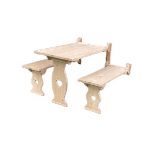

+++
date = 2023-08-20
title = "Tavolo pieghevole"
template = "pages/project.html"

[extra]
img = "table.png"
link = "/it/projects/table"
preTitle = "TAVOLO PIEGHEVOLE"
+++

### Descrizione

</img>

Tavolo pieghevole in legno, realizzato per il mio *maso*, interamente progettato con **sketchUp** e costruito da me nell'estate 2023.
