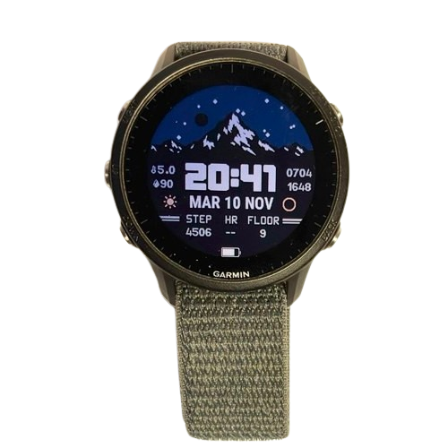

+++
date = 2026-02-16
title = "Quadrante"
template = "pages/project.html"

[extra]
img = "watchface.png"
link = "/it/projects/watchface"
preTitle = "QUADRANTE GARMIN"
+++

## Descrizione

</img>

Questo è un quadrante che ho creato per il mio orologio Garmin, poiché non trovavo niente di soddisfacente per le mie specifiche esigenze.  
La realizzazione è avvenuta a inizio 2026, nel tempo libero dopo la scuola, e successivamente, verso fine estate, ho realizzato un aggiornamento per migliorare alcune funzionalità.

Il progetto è cresciuto più di quanto avessi inizialmente previsto e il risultato finale è stato abbastanza buono, così ho deciso di pubblicarlo su *Connect IQ* (l'app store di Garmin). Al momento è disponibile come <a class="accent-txt" href="https://apps.garmin.com/apps/e755e7f-1b08-46cc-bd74-e9a1cb46053f">Meteo 2.0</a>, e conta più di 100 download.

## Caratteristiche

La funzione principale è lo **sfondo dinamico**, che cambia in base alle condizioni meteorologiche e all'orario. Questo ha richiesto la creazione di un modulo per il calcolo solare, non incluso nel linguaggio base *Monkey C*, che in seguito è stato sostituito con SunCalc per ottenere risultati più precisi.

Altre funzionalità includono i **campi dati**, l'indicatore della batteria, l'indicatore dei secondi (visibile solo in seguito al gesto di movimento del polso) e le **icone meteo e lunari**.

Tutti i font e le immagini utilizzati nella watchface sono stati creati da zero, comprese le icone, e questo ha richiesto un lavoro non indifferente.

Una particolarità di questa watchface, e qualcosa che ho voluto fin dall'inizio del progetto, è l'**elevata possibilità di personalizzazione** di *cosa* vedere, e *come* vederlo. Nelle impostazioni è infatti possibile modificare i colori, i campi dati, lo sfondo e decidere quali elementi mostrare a schermo.

Questo quadrante è inoltre completamente **gratuito e open-source**, e il codice sorgente è pubblicato su <a class="accent-txt" href="https://github.com/vindu07/Weather-2.0">GitHub</a> con licenza MIT.

## Monkey C

Garmin fornisce un <a href="https://developer.garmin.com/connect-iq/overview/" class="accent-txt">SDK</a> per la creazione di app per i suoi dispositivi, e il **linguaggio di programmazione** usato è chiamato *Monkey C*. Esso è una fusione tra diversi linguaggi, come *C++*, *JavaScript*, *Python* e *Php*. 