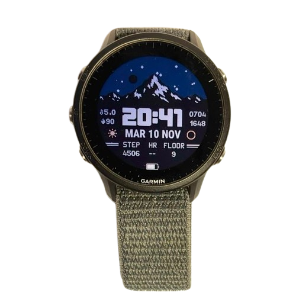

+++
date = 2026-02-16
title = "Watchface"
template = "pages/project.html"

[extra]
img = "watchface.png"
link = "/projects/watchface"
preTitle = "GARMIN WATCHFACE"
+++

## Overview

</img>

This is a watchface I created for my Garmin watch, since I didn't find a satisfying watchface for my specific needs.  
The development took place in early 2026, during my free time after school, and later, towards the end of summer, I released an update to improve some features.

The project grew more then I had originally expected, and the final result was pretty good, so I decided to publish it on the *Connect IQ store* (Garmin's app store). At the moment it is available as <a class="accent-txt" href="https://apps.garmin.com/apps/e755e7f-1b08-46cc-bd74-e9a1cb46053f">Weather 2.0</a>, and has more than 100 downloads.  

## Features

The main feature of this watchface is the **dynamic background**, which changes depending on weather conditions and time.  
This required the creation of a sun calculation module, which is not included in the basic Monkey C language, that was later replaced with SunCalc for more accurate results.

Other features include **data fields**, battery indicator, second indicator (displayed only on wrist gesture), and the **weather and moon icons**.

All the fonts and images used in the watchface have been created from scratch, including the weather and moon icons. 

A peculiarity of this watchface, and something I wanted from the beginning of the project, is the **high possibility of customization** of *what* you see, and *how* you see it. On the settings, you can  change colours, data fields, background and whether to see or not the elements on the screen.

To conclude, the watchface is totally **free and open-source**, and the source code is published on <a class="accent-txt" href="https://github.com/vindu07/Weather-2.0">GitHub</a> under an MIT license.

## Monkey C

Garmin provides a <a href="https://developer.garmin.com/connect-iq/overview/" class="accent-txt">SDK</a> to build apps for his devices, and the **programming language** that is used is called *Monkey C*. It is a fusion of different languages, for example *C++*, *JavaScript*, *Python* and *Php*. 