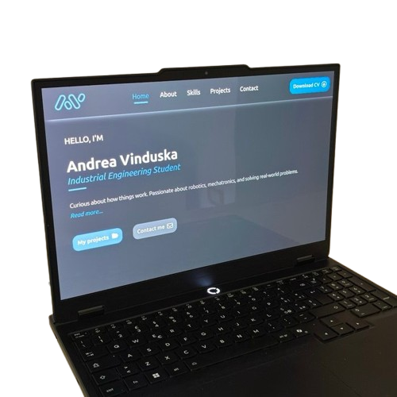

+++ 
date = 2026-10-13
title = "Sito web" 
template = "pages/project.html"

[extra] 
img = "website.png" 
link = "it/projects/website" 
preTitle = "IL MIO SITO WEB" 
+++

### Descrizione

</img>

Avendo del tempo libero e voglia di imparare qualcosa di nuovo, ho deciso di realizzare un sito web dove tenere traccia dei miei progetti e ofrrire informazioni su di me.
Avevo già costruito una piccola webapp per organizzare i compiti, ma stavolta volevo creare una migliore interfaccia grafica e un design reattivo per adattarsi ai diversi schermi.
Il primo risultato è abbastanza buono, ma presenta ancora dei bug e funzionalità mancanti, quindi c'è spazio per migliorare.

### Strumenti usati

Per creare questo sito ho usato il framework *Zola*, che mi ha permesso di creare un sito in due lingue in modo praticamente nativo, senza tuttavia essere complesso da imparare e mantenendo il sito leggero e minimale. 

Zola mi ha aiutato a creare la struttura del sito,ma successivamente ho aggiunto stili e funzionalità interattive tramite *CSS* e *JavaScript* puri, per avere meno dipendenze dall'esterno possibili.
L'ho caricato su *Github Pages* e infine collegato al mio dominio personalizzato.

Per immagini e icone ho usato strumenti online, e *Gimp*.  
La fase di debug e di test è stata invece effettuata su *Firefox* e *Safari* per i dispositivi mobili.
