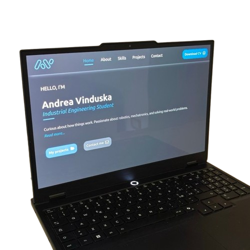

+++ 
date = 2026-10-13
title = "Website" 
template = "pages/project.html"

[extra] 
img = "website.png" 
link = "/projects/website" 
preTitle = "MY WEBSITE" 
+++

### Overview

</img>

Since I had some free time and willingness to learn something new, I decided to build a website where I could place my projects and something about myself.
I had already built a little webapp to track my daily tasks, but this time I wanted to create a better user interface and a responsive design to adapt to different screen sizes.
The first result is quite nice, but has some bugs and missing features, so there's space for improvements.

### Tools I used

To create this website I used the *Zola* framework, because it let me create a dual-language website almost natively, without being too difficult to learn and keeping the website light and minimal. 

Zola helped me create the structure of the website, but then I added style and functionality through pure *CSS* and *JavaScript*, to keep the least possible external dependencies.
I hosted it on *Github Pages* and then linked it to my custom domain.

For images and icons I used online tools, but also *Gimp*.  
The debug and testing part was mostly made on *Firefox* and *Safari* for mobile.
