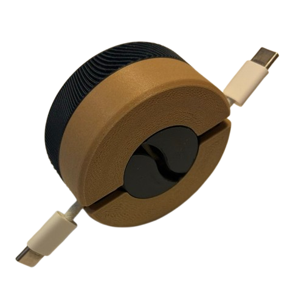

+++
date = 2026-09-10
title = "Avvolgicavo"
template = "pages/project.html"

[extra]
img = "winder.png"
link = "/it/projects/winder"
preTitle = "AVVOLGICAVO"
+++

### Descrizione

</img>

Avvolgitore per cavi flessibili fino a 4mm di spessore e 1m di lunghezza, stampato in PLA in due parti.